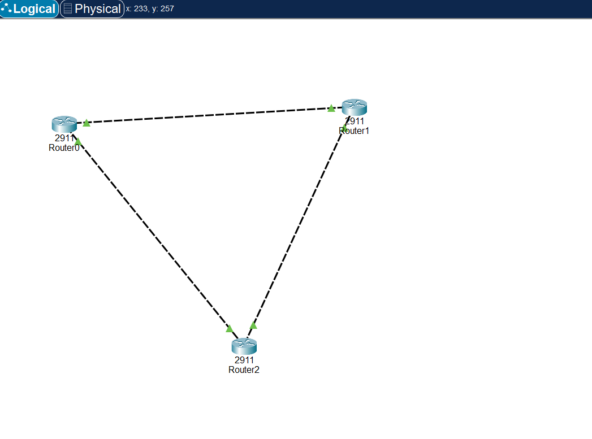

# OSPF Triangle — Dynamic Routing and Automatic Failover

**Date:** October 17, 2026  
**Tool:** Cisco Packet Tracer  
**Level:** Beginner / Intermediate

## 1. Overview

In this lab, I connected three Cisco 2911 routers in a triangle topology and configured Open Shortest Path First (OSPF) to exchange routing information dynamically.

I tested connectivity, examined the routing table, observed OSPF neighbour formation, and deliberately shut down a link to see how the network responded to a failure.

The objective was to understand how dynamic routing provides alternative paths without manually editing routes when the network topology changes.

## 2. Objectives

- Connect three routers in a triangle topology.
- Configure IPv4 addressing on all router-to-router links.
- Enable OSPF in area 0.
- Verify OSPF neighbour relationships and learned routes.
- Identify equal-cost paths in the routing table.
- Simulate a link failure and verify automatic route recalculation.
- Restore the failed link and verify recovery.

## 3. Network Topology



The network contains three routers connected by three point-to-point links. Each link uses a `/30` subnet, providing four total addresses, including two usable host addresses.

### IP Addressing Plan

| Link | Subnet | Router Interface | IP Address |
|---|---|---|---|
| Router0–Router1 | 10.0.0.0/30 | Router0 Gi0/0 | 10.0.0.1 |
| Router0–Router1 | 10.0.0.0/30 | Router1 Gi0/0 | 10.0.0.2 |
| Router1–Router2 | 10.0.0.4/30 | Router1 Gi0/1 | 10.0.0.5 |
| Router1–Router2 | 10.0.0.4/30 | Router2 Gi0/0 | 10.0.0.6 |
| Router2–Router0 | 10.0.0.8/30 | Router2 Gi0/1 | 10.0.0.9 |
| Router2–Router0 | 10.0.0.8/30 | Router0 Gi0/1 | 10.0.0.10 |

**Subnet mask:** `255.255.255.252`

## 4. Technologies and Tools

- Cisco Packet Tracer
- Cisco 2911 routers
- IPv4 addressing and subnetting
- OSPF dynamic routing
- OSPF neighbour relationships
- Routing tables and equal-cost paths
- ICMP ping testing
- Traceroute
- Cisco IOS command-line interface (CLI)

## 5. Implementation

### Step 1: Configure Router Interfaces

I assigned an IP address and subnet mask to each router interface and enabled the interfaces using `no shutdown`.

Example configuration for Router0:

```text
enable
configure terminal
interface GigabitEthernet0/0
 ip address 10.0.0.1 255.255.255.252
 no shutdown
exit
```

I applied the corresponding addresses to the other five interfaces.

Before proceeding, I used the following command to verify interface status:

```text
show ip interface brief
```

### Step 2: Configure OSPF

I enabled OSPF process 1 on Router0 and advertised its two connected subnets in area 0.

```text
router ospf 1
 network 10.0.0.0 0.0.0.3 area 0
 network 10.0.0.8 0.0.0.3 area 0
```

The wildcard mask `0.0.0.3` is the inverse of the `/30` subnet mask `255.255.255.252`.

I configured OSPF on Router1 and Router2 using their respective connected subnets, keeping all three routers in area 0.

### Step 3: Verify OSPF Neighbours

I observed OSPF adjacency messages in the CLI.

The `%OSPF-5-ADJCHG` messages showed neighbour state changes, including transitions from LOADING to FULL.

The FULL state indicated that the routers had completed the required database synchronisation with their neighbours.

### Step 4: Verify Learned Routes

Before OSPF was configured, Router0 did not have a route to the remote `10.0.0.4/30` subnet.

After OSPF converged, I examined the routing table:

```text
show ip route
```

The relevant output was:

```text
O 10.0.0.4/30 [110/2] via 10.0.0.2, ...
                 [110/2] via 10.0.0.9, ...
```

Router0 learned two equal-cost paths to `10.0.0.4/30`.

- `O` identifies a route learned through OSPF.
- `110` is the administrative distance.
- `2` is the OSPF metric.
- `10.0.0.2` and `10.0.0.9` are the next-hop addresses.

Because the paths had equal OSPF metrics, both were installed in the routing table. OSPF can use equal-cost paths for load balancing and redundancy.

### Step 5: Test Connectivity

I tested connectivity from Router0 to Router2's interface at `10.0.0.6`.

```text
ping 10.0.0.6
```

**Result:** 5/5 successful replies after OSPF converged.

This confirmed that Router0 could reach the remote router interface through the configured network.

## 6. Failure Simulation and Automatic Failover

To test redundancy, I shut down Router2's GigabitEthernet0/1 interface, disabling the link between Router2 and Router0.

```text
configure terminal
interface GigabitEthernet0/1
 shutdown
```

### Observations

- The OSPF adjacency associated with the failed link went down.
- The routing table changed as the failed path was removed.
- Router2 retained a path to Router0 through Router1.
- A ping from Router2 to `10.0.0.1` succeeded with 5/5 replies.
- Traceroute showed two hops, with Router1's `10.0.0.5` interface as the intermediate hop.

The network continued to provide connectivity through the surviving path without manually adding or editing routes.

### Restore the Link

I restored the interface:

```text
configure terminal
interface GigabitEthernet0/1
 no shutdown
```

After OSPF reconverged, the neighbour relationship returned to FULL and the redundant path became available again.

The routing table returned to its previous state with two equal-cost paths.

## 7. Troubleshooting and Verification Commands

| Command | Purpose |
|---|---|
| `show ip interface brief` | Verify interface addresses and status |
| `show ip route` | Inspect connected and learned routes |
| `show ip ospf neighbor` | Check OSPF neighbour states |
| `show ip protocols` | Inspect routing protocol configuration |
| `ping 10.0.0.6` | Test IP connectivity |
| `traceroute 10.0.0.1` | Observe the forwarding path |
| `show running-config` | Review the active configuration |
| `no shutdown` | Re-enable an administratively disabled interface |

## 8. What I Learned

- OSPF allows routers to exchange routing information dynamically.
- OSPF Hello packets help routers discover and maintain neighbour relationships.
- A `/30` subnet provides two usable IPv4 addresses, making it suitable for point-to-point links.
- A wildcard mask is the inverse of the subnet mask.
- Equal-cost OSPF routes can provide both load balancing and redundancy.
- When a link fails, OSPF can recalculate routes and use an alternative path if one remains available.
- A PC's default gateway and a router's default route serve different purposes.
- Cisco IOS uses `traceroute`, while Windows commonly uses `tracert`.
- The `do` command allows supported EXEC commands, such as `do show ip route`, to be run from configuration mode.

## 9. Static Routing vs. Dynamic Routing

A basic static route does not dynamically discover alternative paths in the way OSPF does. Depending on the configuration, a static route may become unavailable when its next hop fails.

OSPF exchanges routing information and recalculates available paths as the topology changes. In this lab, that behaviour allowed the routers to maintain connectivity through a surviving link without manually editing routes.

## 10. Challenges and Limitations

This was a simulated lab in Cisco Packet Tracer. The results demonstrate routing behaviour in the simulated environment and do not establish production-network performance or convergence times.

The lab focused on IPv4 routing, neighbour formation, equal-cost paths, and a single-link failure. It did not test authentication, larger OSPF areas, or more complex production network failures.

## 11. Possible Improvements

- Add screenshots showing the routing table before, during, and after the failure.
- Include OSPF neighbour output showing FULL and DOWN states.
- Save and include the working Packet Tracer `.pkt` file.
- Test a different link failure and compare the resulting route.
- Record packet loss during convergence rather than testing only after recovery.
- Add a more detailed diagram showing interface names, IP addresses, and subnet labels.

## 12. Skills Demonstrated

- IPv4 addressing and subnetting
- Cisco IOS interface configuration
- OSPF configuration and verification
- Routing-table interpretation
- Equal-cost path analysis
- Connectivity testing
- Traceroute-based troubleshooting
- Link-failure simulation
- Technical documentation

## 13. Conclusion

This lab helped me understand how OSPF maintains routing information across multiple routers and responds to changes in network topology.

By building a triangle topology, verifying equal-cost routes, and deliberately disabling a link, I demonstrated how dynamic routing can provide an alternative path when a connection fails.

The exercise strengthened my understanding of routing tables, OSPF neighbour relationships, redundancy, and practical network troubleshooting.
